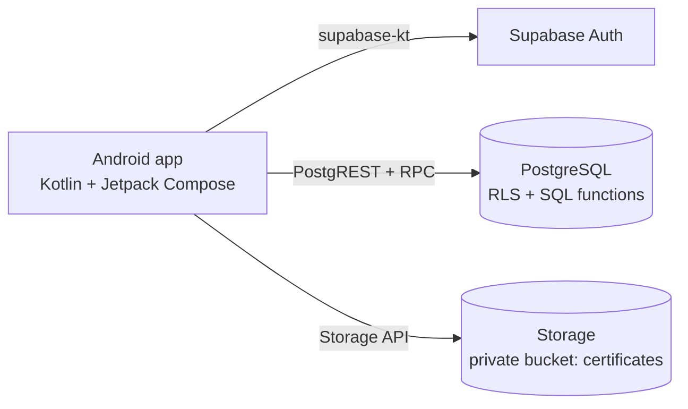

# 🥄 TinySpoon

> A location-based MPASI (complementary baby food) marketplace app that connects busy parents with certified local sellers.

[🇬🇧 English](README.md) · [🇮🇩 Bahasa Indonesia](README.id.md)


---

## About

TinySpoon helps busy parents find and order safe, nutritious baby food from verified UMKM (small business) sellers, filtered by baby age, texture, nutrition, and allergens. Sellers must upload a food-safety certificate and be approved by an admin before they can sell, so parents can trust what they order.

The app was built as a group project for the **Venture Creation** course at Bina Nusantara University (BINUS).

## Download

Get the latest APK from the [Releases page](https://github.com/SunHokk/tinyspoon/releases/latest).

- Requires Android 8.0 (API 26) or newer.
- You may need to allow "Install unknown apps" for your browser or file manager.

## Features

### Buyers (parents)
- Browse and search products; filter by baby age (6–8, 9–11, 12+ months), texture (smooth, soft, coarse), nutrition (high protein, high fibre, low fat), and allergen-free options
- Product detail with per-serving nutrition and allergen information, favourites, and reviews with ratings
- Seller profile with shop info and the verified certificate
- Cart and checkout with saved addresses and three payment methods (simulated); one order is created per seller, with a delivery fee per seller
- Order tracking, order history, and "order again"
- Profile: saved addresses, notification preferences, and app rating

### Sellers
- Register as a seller, upload a certificate (PDF, JPG, or PNG, max 5 MB) to private storage, and follow the verification status (resubmit after a rejection)
- Dashboard with incoming orders and a revenue summary
- Manage products, including nutrition values and allergens (soft delete keeps order history intact)
- Process orders: accept and cook, ship, complete, or reject
- Edit the shop profile

### Admin
- Platform dashboard: users, products, orders, revenue, reviews, orders by status, and top sellers
- Verify sellers: open the uploaded document through a temporary signed link, then approve or reject with a reason
- Manage users: search, filter, and activate or deactivate accounts (deactivated users cannot log in)

## Demo accounts

All demo accounts below share one password: `demoTinyspoon123`

| Role | Email | Notes |
|---|---|---|
| Buyer | `gilbert@email.com` | Demo parent |
| Seller | `dapurbunda@email.com` | Shop: Dapur Bunda |
| Seller | `mpasisehat@email.com` | Shop: MPASI Sehat |
| Seller | `nutrisibayi@email.com` | Shop: Nutrisi Bayi |

The admin account is available on request and is not published here.

> The demo backend is shared, so data can change or be reset at any time.

## Architecture



The app talks directly to Supabase; there is no custom API server. Security relies on PostgreSQL Row Level Security (RLS) and SQL functions that enforce the business rules on the server.

## Tech stack

| Layer | Technology |
|---|---|
| Android app | Kotlin 2.0, Jetpack Compose (Material 3), minSdk 26, targetSdk 35 |
| Supabase client | supabase-kt 3.0 (Auth, Postgrest, Storage), Ktor 3 (OkHttp engine), kotlinx.serialization |
| Backend | Supabase: PostgreSQL with RLS, PL/pgSQL functions, Auth, Storage |
| Tooling | Supabase CLI (migrations), Node.js with supabase-js (seed and automated tests) |

## Security highlights

- RLS is enabled on all 12 tables. Default privileges are revoked and granted back table by table (and column by column where needed).
- Business rules live in SQL functions and are checked on the server: `place_order`, `set_order_status`, `submit_review`, `submit_certificate`, `review_shop`, `set_user_active`, and more.
- Certificates are stored in a private bucket. Admins open them through signed links that expire after 5 minutes.
- The app ships only the public anon key. The service role key is used by the backend scripts only and stays in `backend/.env`, which is git-ignored.
- Admin accounts cannot be created through sign-up.

## Project structure

```
tinyspoon/
├── android/                         # Android app (open this folder in Android Studio)
│   └── app/src/main/java/id/tinyspoon/app/
│       ├── data/                    # Supabase repositories (auth, catalog, orders, seller, profile, admin)
│       └── ui/                      # Screens (buyer, seller, admin) and theme
├── backend/
│   ├── supabase/migrations/         # Database schema, RLS policies, SQL functions
│   └── scripts/                     # Seed script and automated tests
├── LICENSE
└── README.md
```

## Getting started

### 1. Backend (Supabase)

Requirements: Node.js 20.6 or newer (22 recommended) and a free [Supabase](https://supabase.com) project.

1. In the Supabase dashboard, go to **Authentication → Providers → Email** and turn **off** "Confirm email".
2. Install dependencies and apply the migrations:

   ```bash
   cd backend
   npm install
   npx supabase login
   npx supabase link --project-ref <your-project-ref>
   npx supabase db push
   ```

3. Create `backend/.env` from the example and fill in your own values (Supabase dashboard → Project Settings → API):

   ```bash
   cp .env.example .env        # Windows: copy .env.example .env
   ```

   | Variable | Purpose |
   |---|---|
   | `SUPABASE_URL` | Your project URL |
   | `SUPABASE_ANON_KEY` | Public anon key |
   | `SUPABASE_SERVICE_ROLE_KEY` | Service role key, used by the scripts only |
   | `SEED_DEMO_PASSWORD` | Password for the demo buyer and sellers |
   | `SEED_ADMIN_PASSWORD` | Password for the demo admin |

   > Never commit `.env`. The service role key bypasses RLS: keep it out of the app and out of the repository.

4. Seed the demo data (1 buyer, 3 verified sellers, 1 admin, 8 products, and sample reviews):

   ```bash
   npm run seed
   ```

5. Optionally run the automated tests against your project:

   ```bash
   npm run test:auth
   npm run test:catalog
   npm run test:orders
   npm run test:profile
   npm run test:admin
   ```

   The tests sign in as the demo accounts and create temporary test data, so run them only against your own project.

### 2. Android app

Requirements: a recent Android Studio and Android SDK 35.

1. Open the `android/` folder in Android Studio (not the repository root).
2. Create or edit `android/local.properties` and add your project values (the file is git-ignored):

   ```properties
   SUPABASE_URL=https://<your-project-ref>.supabase.co
   SUPABASE_ANON_KEY=<your anon key>
   ```

   Use the **anon** key here, never the service role key.
3. Sync Gradle and run the app on an emulator or device (Android 8.0+).

To build a release APK, use **Build → Generate Signed App Bundle / APK** in Android Studio with your own keystore.

## Business

- **Model:** a commission on each transaction, charged to sellers.
- **Differentiation:** a multi-seller marketplace dedicated to baby food (not a single-brand or catering service), with certificate verification built into the app.
- **Roadmap:**
  - Year 1: validate the model in one city
  - Year 3: expand regionally
  - Year 5: become the reference standard for online MPASI
  - Year 10: grow into a nutrition ecosystem for pregnant and breastfeeding mothers

## Known limitations

- Payment and delivery are simulated; there is no payment gateway or courier integration.
- "Forgot password" shows a confirmation but does not send an email yet.
- Notification preferences are saved, but no notifications are sent.
- Order status does not refresh automatically; reopen the screen to see updates.
- Sellers see an approval result only after logging in again.
- The location text ("Jakarta Selatan") and the promo banner on the Home screen are static placeholders; no discount is applied.
- A free-tier Supabase project can pause after a period of inactivity.

## Team

**Group 3, Venture Creation, Bina Nusantara University (BINUS)**

- Alifmikailavi Mohammad
- Nicholas Ghonius
- Stawin Revano
- Gilbert Nicholin

## License

Released under the [MIT License](LICENSE).
